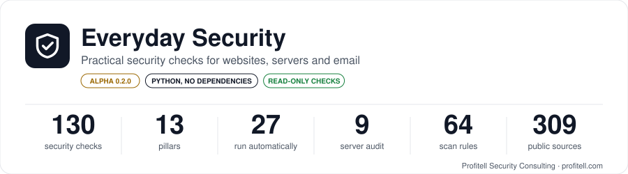
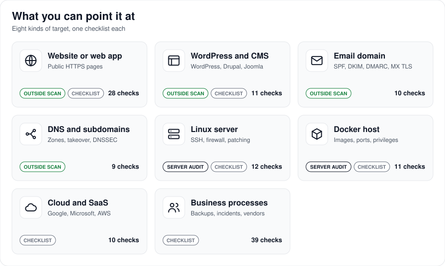

# Everyday Security

<p align="center"><a href="docs/coverage/README.md"></a></p>

**Practical, evidence-based security checks for small-business websites, servers and mail.**
By [Profitell Security Consulting](https://www.profitell.com/) · [github.com/profitelai/everyday-security](https://github.com/profitelai/everyday-security) · [Demo](https://www.danimaster.com/security-audit)

`version 0.2.0` · `Apache-2.0` · `Python 3.9+, standard library only` · `local-first: nothing is sent anywhere except the requests you ask for`

> **Status: Alpha (0.2.x).** Experimental, for systems you own or have written permission to test. The 130 checks are drafts written from cited public sources and have not yet been reviewed by a named human security professional. Detection accuracy has not been measured against known-good and known-bad systems, so a finding can be wrong (false alarm) and a clean result is not proof of safety. Do not use it as the only basis for a security, compliance or legal decision. See the [Disclaimer](#disclaimer).

**Tags:** `security-audit` `tls` `http-security-headers` `csp` `hsts` `cookies` `cors` `dns` `small-business` `checklist` `owasp-aligned` `python` `no-dependencies`

## At a glance

**[What can it scan? Targets, methods, limits (no zero-days), standards →](docs/coverage/README.md)**

<p align="center"><a href="docs/coverage/README.md"></a></p>

<!-- COUNTS:START -->
| Measured from `kb/` | Count |
|---|---:|
| Pillars | **13** |
| Security checks | **130** |
| Run automatically by the site checker | **27** |
| Run by the server audit (`audit-host`, on the server itself) | **9** |
| Manual (sign-in or human review) | **94** |
| Tags | **68** |
| Public sources cited | **309** |

| Pillar | Checks | Critical | High | Medium | Low | Site scan | Server audit |
|---|---:|---:|---:|---:|---:|---:|---:|
| [`backups-and-recovery`](kb/backups-and-recovery/) | 9 |  | 7 | 2 |  | 0/9 | 0 |
| [`cloud-and-saas-accounts`](kb/cloud-and-saas-accounts/) | 10 | 1 | 6 | 3 |  | 0/10 | 0 |
| [`containers`](kb/containers/) | 11 | 1 | 6 | 4 |  | 0/11 | 0 |
| [`dns`](kb/dns/) | 9 |  | 4 | 4 | 1 | 4/9 | 0 |
| [`http-headers`](kb/http-headers/) | 10 |  | 4 | 3 | 3 | 10/10 | 0 |
| [`incident-response`](kb/incident-response/) | 10 |  | 7 | 3 |  | 0/10 | 0 |
| [`mail-authentication`](kb/mail-authentication/) | 10 | 1 | 5 | 4 |  | 8/10 | 0 |
| [`privacy-compliance`](kb/privacy-compliance/) | 10 |  | 7 | 3 |  | 0/10 | 0 |
| [`server-hardening`](kb/server-hardening/) | 12 |  | 7 | 5 |  | 0/12 | 8 |
| [`tls`](kb/tls/) | 6 |  | 4 | 1 | 1 | 5/6 | 1 |
| [`vendor-and-supply-chain`](kb/vendor-and-supply-chain/) | 10 |  | 6 | 4 |  | 0/10 | 0 |
| [`web-app`](kb/web-app/) | 12 | 1 | 7 | 4 |  | 0/12 | 0 |
| [`wordpress-and-cms`](kb/wordpress-and-cms/) | 11 |  | 6 | 5 |  | 0/11 | 0 |
| **Total** | **130** | **4** | **76** | **45** | **5** | **27/130** | **9** |
<!-- COUNTS:END -->

Full list with tags, tools and severity: [`kb/INDEX.md`](kb/INDEX.md). The counts above are generated from the files in `kb/` by `tools/kb/build_index.py`, so they always match the content.

**Newest pillars (draft, awaiting human technical review):** incident response, cloud and SaaS accounts, WordPress and CMS, containers, vendor and supply chain. Every figure in the table above includes them.

## The scan engine (v0.2)

Everyday Security scans one site or your whole network, stores every run, and shows what changed since last time. It is built to take **thousands of new data points** without code changes.

```bash
./everyday.sh scan example.com                                   # one site
./everyday.sh scan --sites sites/network.json                    # all your sites
./everyday.sh scan --sites sites/network.json --deep --i-own-these   # also probe sensitive paths (your own sites only)
./everyday.sh ingest --type path_probe --file new.csv --source <URL> --license <licence>   # add data (lands as pending)
./everyday.sh approve data/incoming/<file>.json --reviewer "Name"                        # a person makes it live
./everyday.sh audit-host                                        # run ON a server: read-only audit of SSH, firewall, ports, Docker, updates, fail2ban, clock, web-root permissions, cert renewal
./everyday.sh list checks|packs|runs ; ./everyday.sh validate ; ./everyday.sh stats
```

Reports (HTML, Markdown, CSV, JSON) go to `reports/runs/<timestamp>/`. See [`docs/ARCHITECTURE.md`](docs/ARCHITECTURE.md) and [`docs/DATA-FORMAT.md`](docs/DATA-FORMAT.md). It also installs as a Claude plugin (`.claude-plugin/`) with `/scan` and `/add-data`.

## What you can check

| You want to check | Pillars | Run it with |
|---|---|---|
| Any website or domain you own or may test, from the outside | `tls`, `http-headers`, `mail-authentication`, `dns` (19 automatic checks) | `tools/check/everyday_check.py` or the workbench page "Check a website" |
| A server you run (all its domains, mail records, exposed ports, pending updates) | the same, plus `server-hardening` (read-only commands in each check) | `tools/scanner/security_review.py` (run on the server) |
| One specific item by hand, including code, backups and privacy practice | any check in `kb/` (`web-app`, `backups-and-recovery`, `privacy-compliance` are review-based) | each check file lists the exact commands or review steps |

## How you check

Every check is one file in `kb/<pillar>/<ID>.md` with the same sections: **why it matters · how to test (commands) · pass criteria · fix · risk and rollback**, plus tags, severity, the standards it follows and the sources it cites (`docs/sources.md`).

A check is either **automatic** (the site checker can judge it from outside) or **manual** (it needs server access or a signed-in session; the file tells you how).

Results are `PASS`, `WARN`, `FAIL`, `INCONCLUSIVE` (not enough evidence to judge, for example a blocked port) or `MANUAL` (needs a human). A finding can carry recorded evidence and a confidence level.

## How to run the tools

**1. Check a website (from the outside, a few ordinary requests):**

```bash
python3 tools/check/everyday_check.py example.com
python3 tools/check/everyday_check.py example.com --json     # machine-readable
```

Only test sites you own or have written permission to test. A normal scan makes ordinary connections to the site (HTTPS on port 443, and a plain request on port 80 to see the redirect), DNS lookups, a zone-transfer request (`AXFR`) to each name server of the domain, and a connection to each mail server on port 25 to see whether it offers encryption. It never tries passwords or logins. Sensitive paths (such as `.env` and `.git`) are requested only with `--deep --i-own-these`.

**2. Open the local workbench** (browse checks by pillar, tag and severity; run the site checker from a form; inspect provenance):

```bash
python3 tools/workbench/server.py        # then open http://127.0.0.1:5090
```

**3. Review a whole server** (run on the server; discovers every nginx domain, reads DNS and mail records, reports exposed ports):

```bash
sudo SECURITY_REVIEW_EMAIL=you@example.com python3 tools/scanner/security_review.py --no-mail
```

**4. Keep the knowledge base honest:**

```bash
python3 tools/kb/lint.py                  # every check has its fields, sections and known sources
python3 tools/kb/build_index.py           # regenerate kb/INDEX.md and the counts above
python3 tools/kb/similarity.py PATH...    # measure overlap with reference folders before a release
```

## Repository map

| Path | What it is |
|---|---|
| `kb/` | The checks, one file each, grouped by pillar. `kb/INDEX.md` is the generated index. |
| `docs/sources.md` | Source ledger: every public standard the checks cite, with its usage note. |
| `docs/PROVENANCE.md` | Where every part of this repository comes from. |
| `tools/check/` | Site checker (outside view, standard library only). |
| `tools/scanner/` | Server-wide review with history, tickets and optional status email. |
| `tools/workbench/` | Local browser tool: checks, site checker form, provenance and copyright inventory. |
| `tools/kb/` | Lint, index builder, similarity checker. |

## Provenance and independence

Everything here is written by Profitell Security Consulting from public standards (IETF RFCs, W3C and WHATWG specifications, vendor documentation). OWASP cheat sheets are cited, never copied. No third-party knowledge-base content is included. See [`docs/PROVENANCE.md`](docs/PROVENANCE.md).

## License

## Disclaimer

Everyday Security and its checks are provided for information only, "as is", without warranty of any kind (see `LICENSE`). Nothing here is legal, privacy, compliance, financial or professional security advice, and no check is a certification or a guarantee that a system is secure or compliant. Laws, standards, dates and time limits change; confirm the current text of the cited source or ask a qualified professional before relying on any check. You are responsible for having permission to scan any system, and for how you use the results. Profitell Security Consulting is not liable for scans you run or decisions you take.

Apache-2.0, Copyright 2026 Profitell Security Consulting. See `LICENSE` and `NOTICE`.

---

**Profitell Security Consulting** · [https://www.profitell.com/](https://www.profitell.com/) · [https://github.com/profitelai/everyday-security](https://github.com/profitelai/everyday-security)
