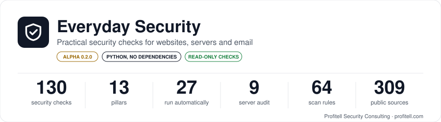
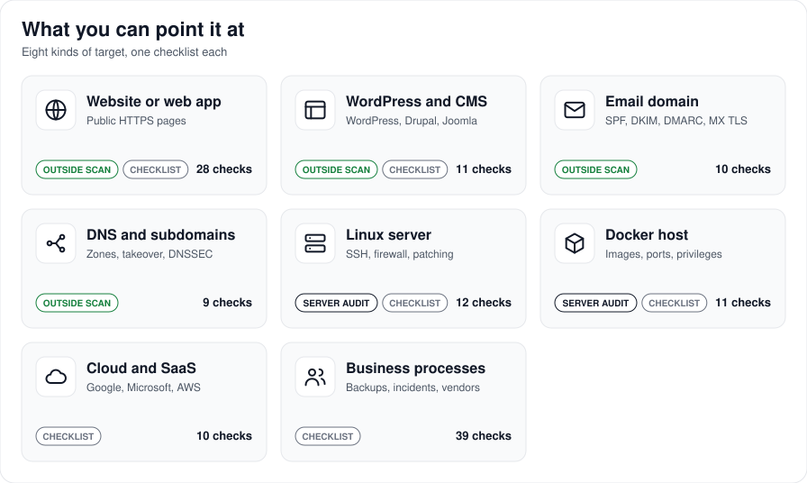
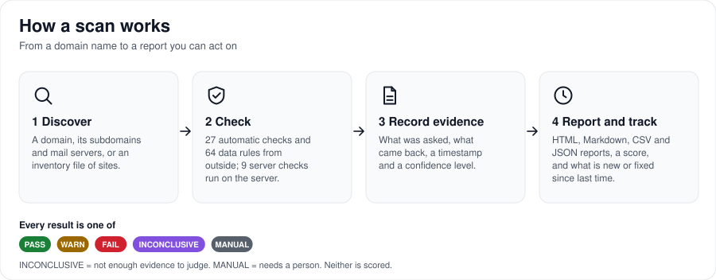
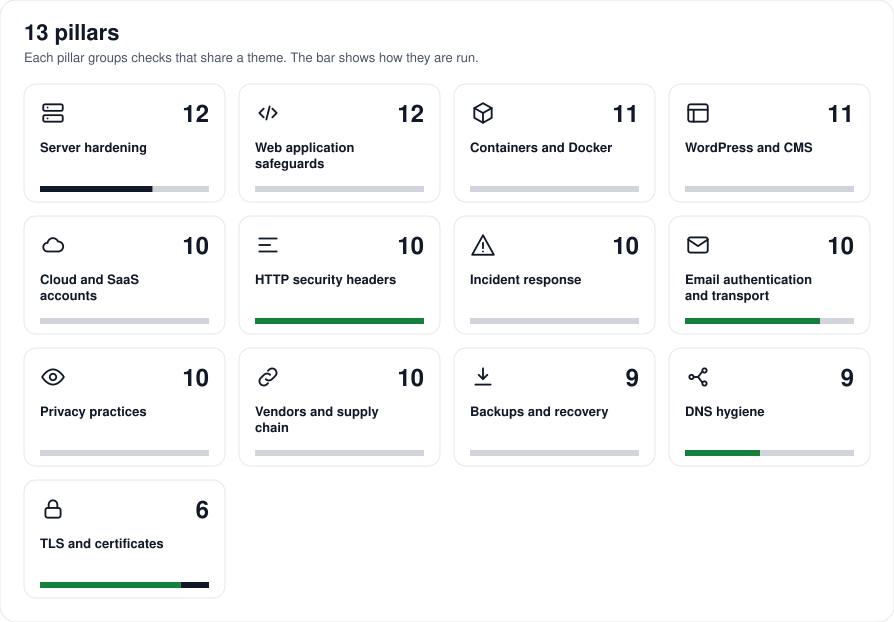
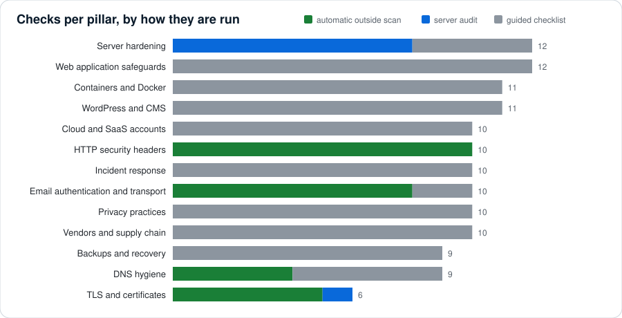

# What Everyday Security can scan

> **Status: Alpha (0.2.0).** The checks are drafts written from cited public sources and have not yet been reviewed by a named human security professional or measured against known-good and known-bad systems. A finding can be wrong, and a clean result is not proof of safety. Only scan systems you own or have written permission to test. This page is generated from the repository by `tools/kb/build_coverage.py`, so the numbers always match the content.

## At a glance

| | |
|---|---:|
| Security checks | **130** in **13** pillars |
| Run automatically against a website or domain | **27** |
| Run by the read-only server audit (on the server itself) | **9** |
| Guided checklists for a person (not automatable from outside) | **94** |
| Data-driven scan rules | **64** (44 path probe, 8 http header, 5 takeover, 4 banner version, 3 dns record) |
| Severity | 4 critical · 76 high · 45 medium · 5 low |
| Public sources cited | **309** |

## What can I point it at?

| Target | What is examined | How | Pillars |
|---|---|---|---|
| Website or web app | Public HTTPS and HTTP pages | Automatic outside scan | tls, http-headers, web-app, dns |
| Email domain | DNS records and the mail servers' port 25 | Automatic outside scan | mail-authentication, dns |
| Whole domain and its subdomains | DNS, certificates, takeover fingerprints | Automatic outside scan (fleet) | dns, tls |
| Linux server | Local configuration, read-only | Server audit run on the server | server-hardening |
| WordPress or other CMS site | Public paths plus a checklist | Outside scan and guided checklist | wordpress-and-cms |
| Docker host | Published ports plus a checklist | Server audit and guided checklist | containers |
| Cloud and SaaS accounts | Your admin consoles | Guided checklist (human) | cloud-and-saas-accounts |
| Business processes | Backups, incidents, vendors | Guided checklist (human) | backups-and-recovery, incident-response, vendor-and-supply-chain, privacy-compliance |

## How a check is run

| Method | Count | What happens |
|---|---:|---|
| Automatic outside scan | 27 | Ordinary web requests, TLS handshakes, DNS lookups, and a look at the domain's mail servers. Plus 64 data rules: sensitive paths, headers, end-of-life versions, takeover fingerprints, DNS expectations. |
| Server audit | 9 | `audit-host` reads local configuration on a Linux server (SSH, firewall, ports, Docker, updates, fail2ban, clock, permissions, certificate renewal). Read-only, no network calls. |
| Guided checklist | 94 | Each check explains why it matters, how to test it by hand, the pass criteria, the fix and the rollback. A person confirms the answer. |

## Do you scan for zero-days? No.

Everyday Security is a **configuration and exposure checker**, not a vulnerability hunter. It looks for well-known, documented weaknesses that small businesses commonly have. It does not discover unknown flaws.

| Question | Answer |
|---|---|
| Zero-day vulnerabilities | No. We do not hunt unknown flaws and we do not use a live exploit or CVE feed. |
| Known CVEs in installed software | Not by matching a vulnerability database. A short, hand-written list of end-of-life versions is checked when a server announces its version. Use a dedicated tool such as Trivy for CVEs (the checks explain how). |
| Exploitation and penetration testing | No. Nothing is exploited, no payloads are sent, no passwords or logins are tried. |
| Port scanning of ranges | No. Only ports 80 and 443 of the site, port 25 of its mail servers, and DNS queries (including a zone-transfer request to its name servers) are used. |
| Logged-in application testing | No. Only what an anonymous visitor can see. |
| Malware or intrusion detection | No. |
| Load or denial-of-service testing | No. |
| Compliance certification | No. Checks cite standards; passing them does not certify anything. |

## What the data rules look for

| Rule type | Count | Example |
|---|---:|---|
| path probe | 44 | Is `/.env`, `/.git/HEAD` or a database dump downloadable? |
| http header | 8 | Is a recommended security header missing? |
| takeover | 5 | Does a subdomain point at an unclaimed GitHub Pages or Heroku app? |
| banner version | 4 | Does the server announce an end-of-life Apache or PHP version? |
| dns record | 3 | Is DMARC still monitor-only? Does SPF allow every sender? |

## Pillars

| Pillar | What it covers | Checks | Auto | Server | Checklist | For |
|---|---|---:|---:|---:|---:|---|
| [Server hardening](pillars/server-hardening.md) | SSH, firewall, listening ports, patching, fail2ban, clock, file permissions, certificate renewal. | 12 | 0 | 8 | 4 | Linux servers you administer |
| [Web application safeguards](pillars/web-app.md) | Login, sessions, uploads, injection, access control and error handling (review-based). | 12 | 0 | 0 | 12 | Sites and apps you build or run |
| [Containers and Docker](pillars/containers.md) | Image sources and tags, scanning, privileges, published ports, secrets, resource limits. | 11 | 0 | 0 | 11 | Docker and Compose hosts |
| [WordPress and CMS](pillars/wordpress-and-cms.md) | Updates, plugins, admin exposure, XML-RPC and REST user listing, backups, form spam. | 11 | 0 | 0 | 11 | WordPress, Drupal, Joomla and similar sites |
| [Cloud and SaaS accounts](pillars/cloud-and-saas-accounts.md) | Admin accounts, MFA, OAuth grants, public storage, offboarding, account inventory. | 10 | 0 | 0 | 10 | Teams using Google, Microsoft, AWS and similar |
| [HTTP security headers](pillars/http-headers.md) | HSTS, CSP, frame protection, cookies, CORS, caching of private pages, version disclosure. | 10 | 10 | 0 | 0 | Any website or web app |
| [Incident response](pillars/incident-response.md) | Plan, owners, contacts, evidence, logging, communication, recovery and post-incident review. | 10 | 0 | 0 | 10 | Any business |
| [Email authentication and transport](pillars/mail-authentication.md) | SPF, DKIM, DMARC, MTA-STS, MX encryption (STARTTLS), reverse DNS. | 10 | 8 | 0 | 2 | Any domain that sends or receives mail |
| [Privacy practices](pillars/privacy-compliance.md) | Policy, consent, data inventory, retention, incident register, access requests. Informational, not legal advice. | 10 | 0 | 0 | 10 | Businesses holding personal information |
| [Vendors and supply chain](pillars/vendor-and-supply-chain.md) | Vendor inventory and contracts, dependencies, CI/CD pipelines, third-party scripts, exit plans. | 10 | 0 | 0 | 10 | Any business and any developer |
| [Backups and recovery](pillars/backups-and-recovery.md) | 3-2-1 copies, offsite and immutable copies, restore tests, retention, database dumps. | 9 | 0 | 0 | 9 | Any business running systems |
| [DNS hygiene](pillars/dns.md) | Zone transfers, dangling records, private addresses in public DNS, DNSSEC, expiry of names. | 9 | 4 | 0 | 5 | Any domain |
| [TLS and certificates](pillars/tls.md) | HTTPS certificates, expiry, protocol versions, ciphers, redirects from HTTP. | 6 | 5 | 1 | 0 | Any website |

## Standards the checks reference

Checks cite public standards and primary documentation. This is a reference list, not a claim of certification or full coverage of any framework.

| Standards family | Checks that cite it |
|---|---:|
| NIST | 59 |
| OWASP | 37 |
| IETF RFCs | 26 |
| CIS | 14 |
| Privacy law (informational) | 12 |
| W3C / WHATWG | 6 |
| Canadian Centre for Cyber Security | 3 |
| Audit frameworks | 2 |

The complete list with links is in [`docs/sources.md`](../sources.md) and [`docs/sources.d/`](../sources.d/).

## Maturity

| Level | Meaning | |
|---|---|---|
| **Alpha (now)** | Fixture-tested logic; drafts; own systems only | current |
| Beta | Benchmarked against known-good and known-bad systems, evidence in every finding | planned |
| 1.0 | Independently reviewed and validated | planned |

Every result is `PASS`, `WARN`, `FAIL`, `INCONCLUSIVE` (not enough evidence) or `MANUAL` (needs a person), and can carry recorded evidence and a confidence level.

## More

- [All checks, one table](../../kb/INDEX.md)
- [How the engine works](../ARCHITECTURE.md)
- [Where the content comes from](../PROVENANCE.md)
- [Review queue: what is still unverified](../REVIEW-QUEUE.md)
- [Automation roadmap: why not every check runs by itself](../AUTOMATION-ROADMAP.md)
- [Back to the project README](../../README.md)

## Disclaimer

Provided for information only, as is, without warranty. Not legal, privacy, compliance or professional security advice. See the Disclaimer in the project README.
